# SpendWise – Smart Expense Tracker


---


Download the latest debug APK 📦 :

[](app/build/outputs/apk/debug/SpendWise.apk)


SpendWise is a professional-grade Android expense tracking application designed to help users record, analyze, and export personal financial data securely. Built with **Java** and **Firebase**, it offers real-time synchronization, offline support, and clean analytics suitable for both academic and real-world use.

---

## 📑 Table of Contents

- Overview
- Features
- Technology Stack
- System Architecture
- Project Structure
- Screenshots
- Firebase Data Model
- Firebase Security Rules
- Setup & Installation
- Testing
- Deployment Checklist
- Future Enhancements
- Authors
- License

---

## 📝 Overview

With rising living costs, managing personal finances effectively has become essential. Traditional expense tracking methods lack automation, insights, and security. SpendWise provides a modern, mobile-first solution enabling users to:

- Instantly log expenses
- Analyze category-wise and monthly spending
- Export reports
- Securely store data in the cloud

---

## ✨ Key Features

- Firebase Authentication (Email & Password)
- Add, edit, and delete expenses
- Category-wise expense tracking
- Monthly and total summaries
- Dashboard with analytics and charts
- Offline-first with automatic sync
- CSV & PDF report export
- Secure, user-isolated cloud storage

---

## 🛠️ Technology Stack

| Layer | Technology |
|------|-----------|
| Frontend | Android (Java, XML) |
| Backend | Firebase Realtime Database |
| Authentication | Firebase Auth |
| Storage | Firebase Storage |
| Charts | MPAndroidChart |
| Build Tool | Gradle (Kotlin DSL) |

---

## 🧩 System Architecture

```bash
  Android App
  │
  ├── Firebase Authentication
  │
  ├── Firebase Realtime Database
  │ └── User-Isolated Data
  │
  └── Firebase Storage (Exports)
```

---

## 📂 Project Structure

```bash
app/
├── manifests/
│   └── AndroidManifest.xml
│
├── java/
│   └── com/
│       └── ra/
│           └── set/
│               ├── activities/
│               │   ├── AddExpenseActivity.java
│               │   ├── DashboardActivity.java
│               │   ├── EditExpenseActivity.java
│               │   ├── ExpensesActivity.java
│               │   ├── ExportActivity.java
│               │   ├── LoginActivity.java
│               │   ├── ProfileActivity.java
│               │   ├── RegisterActivity.java
│               │   └── ReportsActivity.java
│               │
│               ├── adapters/
│               │   ├── CategorySummaryAdapter.java
│               │   └── ExpenseAdapter.java
│               │
│               ├── models/
│               │   ├── CategorySummary.java
│               │   ├── Expense.java
│               │   └── LoginRequest.java
│               │
│               ├── network/
│               │   ├── ApiClient.java
│               │   └── ApiService.java
│               │
│               └── utils/
│                   ├── DateUtils.java
│                   ├── PasswordUtils.java
│                   ├── SessionTimeout.java
│                   ├── MainActivity.java
│                   └── SETApp.java
│
├── res/
│   ├── drawable/
│   │   ├── bg_avatar.xml
│   │   ├── bg_card.xml
│   │   ├── bg_category.xml
│   │   ├── bg_circle_avatar.xml
│   │   ├── bg_icon.xml
│   │   ├── card_bg.xml
│   │   ├── ic_add.xml
│   │   ├── ic_app.xml
│   │   ├── ic_calendar.xml
│   │   ├── ic_dashboard.xml
│   │   ├── ic_expenses.xml
│   │   ├── ic_exports.xml
│   │   ├── ic_reports.xml
│   │   ├── ic_search.xml
│   │   └── ic_wallet.xml
│   │
│   ├── layout/
│   │   ├── activity_add_expense.xml
│   │   ├── activity_dashboard.xml
│   │   ├── activity_edit_expense.xml
│   │   ├── activity_expenses.xml
│   │   ├── activity_export.xml
│   │   ├── activity_login.xml
│   │   ├── activity_profile.xml
│   │   ├── activity_register.xml
│   │   ├── activity_reports.xml
│   │   ├── dialog_change_password.xml
│   │   ├── dialog_edit_profile.xml
│   │   ├── dialog_reset_password_full.xml
│   │   ├── bottom_nav.xml
│   │   ├── top_bar_card.xml
│   │   ├── layout_piechart_breakdown.xml
│   │   └── item_category_summary.xml
│   │
│   ├── menu/
│   │   └── menu_profile.xml
│   │
│   ├── values/
│   │   ├── arrays.xml
│   │   ├── colors.xml
│   │   ├── ids.xml
│   │   ├── strings.xml
│   │   └── themes.xml
│   │
│   └── xml/
│       ├── backup_rules.xml
│       └── data_extraction_rules.xml
│
├── java (generated)/
├── res (generated)/
└── Gradle Scripts/
    ├── build.gradle.kts (Project)
    ├── build.gradle.kts (Module: app)
    ├── gradle.properties
    ├── gradle-wrapper.properties
    ├── local.properties
    ├── settings.gradle.kts
    ├── libs.versions.toml
    └── proguard-rules.pro
```

---

## 📸 Screenshots

### Intuitive App Screens — Login & Registration

<table>
  <tr>
    <td align="center" width="300">
      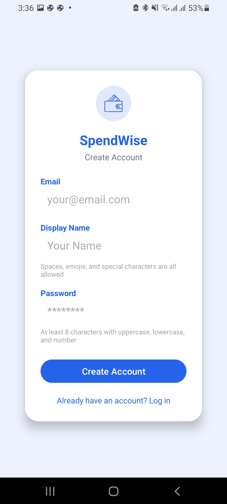<br/>
      <b>Create Account</b><br/>
      <sub>User registration with email, name, and password</sub>
    </td>
    <td align="center" width="300">
      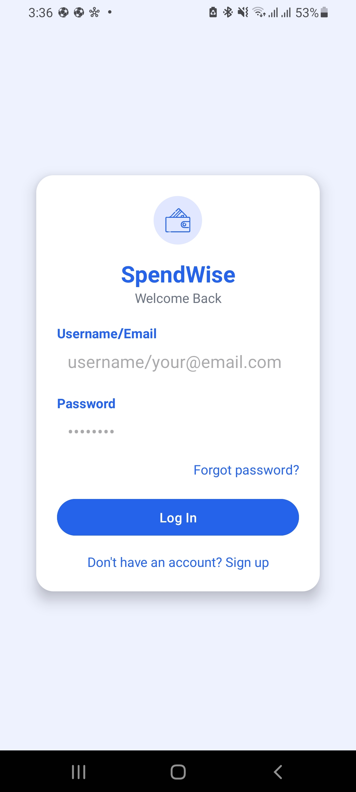<br/>
      <b>Login</b><br/>
      <sub>Secure login using Firebase Authentication</sub>
    </td>
    <td align="center" width="300">
      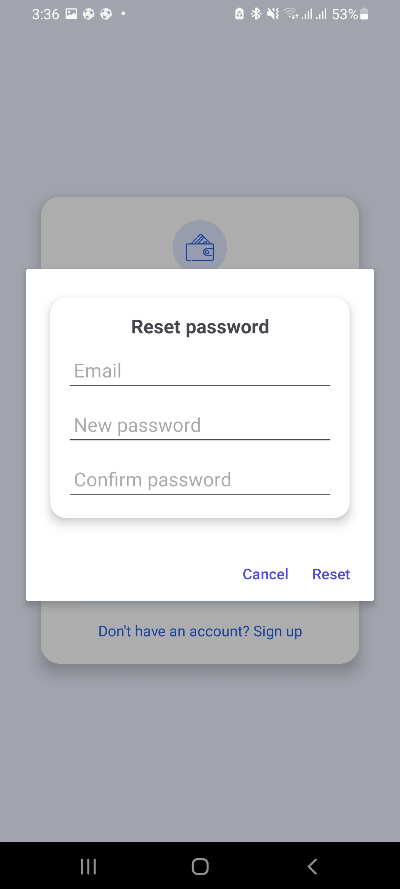<br/>
      <b>Password Reset</b><br/>
      <sub>Reset password via email verification</sub>
    </td>
  </tr>
</table>

### Intuitive App Screens — Dashboard Summary

<table>
  <tr>
    <td align="center" width="450">
      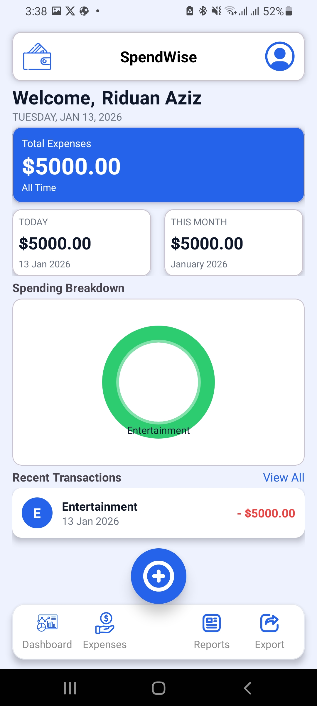<br/>
      <b>Dashboard Overview</b><br/>
      <sub>Quick snapshot of total expenses and trends</sub>
    </td>
    <td align="center" width="450">
      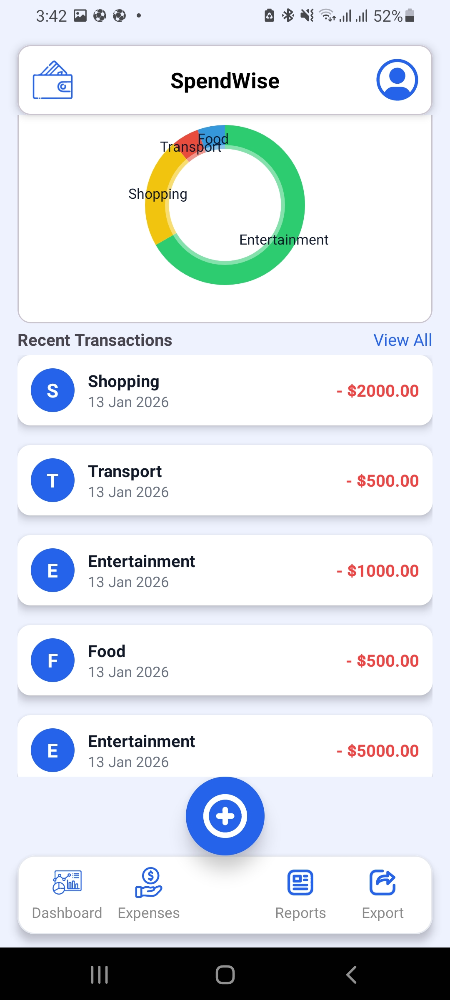<br/>
      <b>Expense Analytics</b><br/>
      <sub>Category-wise visualization using charts</sub>
    </td>
  </tr>
</table>


### Intuitive App Screens — View / Add / Edit Expense

<table>
  <tr>
    <td align="center" width="300">
      <br/>
      <b>Expense List</b><br/>
      <sub>Scrollable list of recorded expenses</sub>
    </td>
    <td align="center" width="300">
      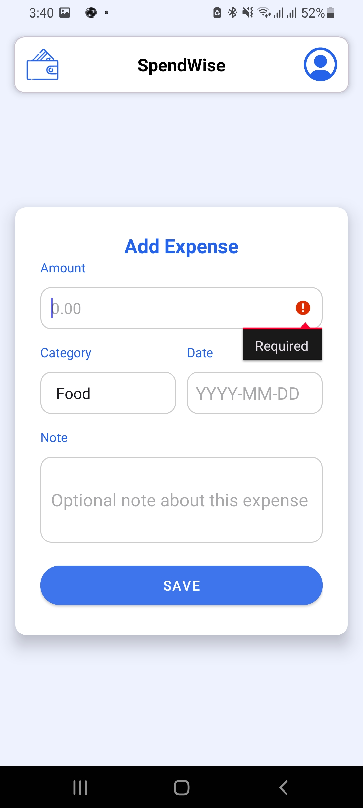<br/>
      <b>Add Expense</b><br/>
      <sub>Simple form for quick data entry</sub>
    </td>
    <td align="center" width="300">
      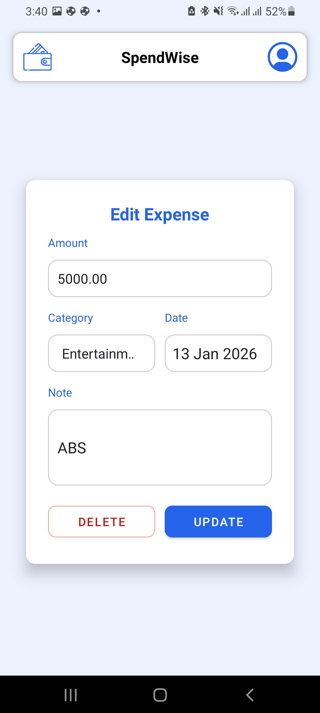<br/>
      <b>Edit Expense</b><br/>
      <sub>Update or correct existing records</sub>
    </td>
  </tr>
</table>

### Intuitive App Screens — Filter Expenses

<table>
  <tr>
    <td align="center" width="300">
      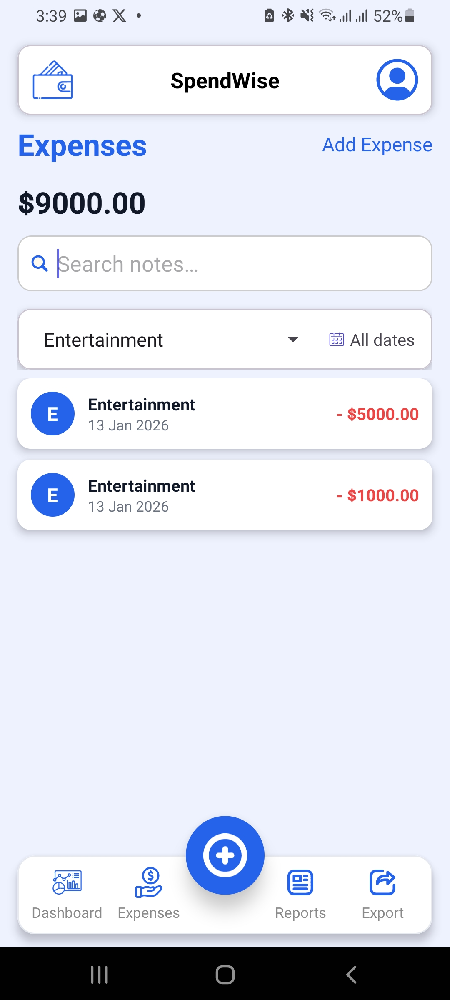<br/>
      <b>Category Filter</b><br/>
      <sub>View expenses by category</sub>
    </td>
    <td align="center" width="300">
      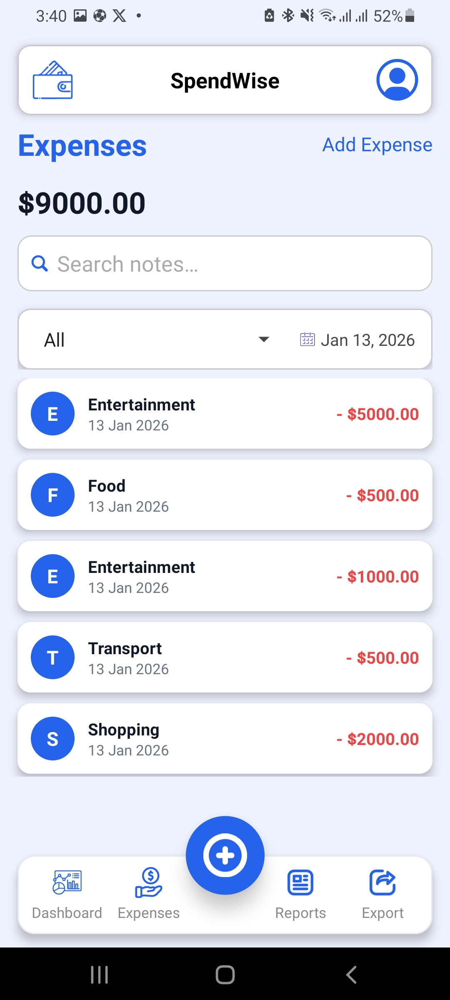<br/>
      <b>Date Filter</b><br/>
      <sub>Filter by custom date range</sub>
    </td>
    <td align="center" width="300">
      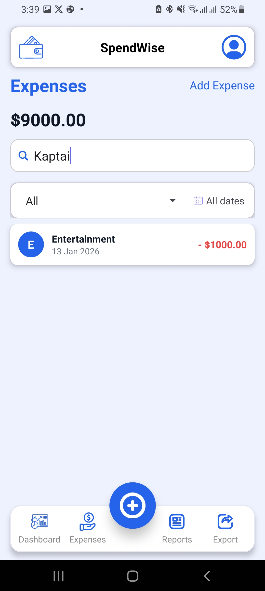<br/>
      <b>Search</b><br/>
      <sub>Quick notes-based filtering</sub>
    </td>
  </tr>
</table>

### Intuitive App Screens — Reports & Export

<table>
  <tr>
    <td align="center" width="450">
      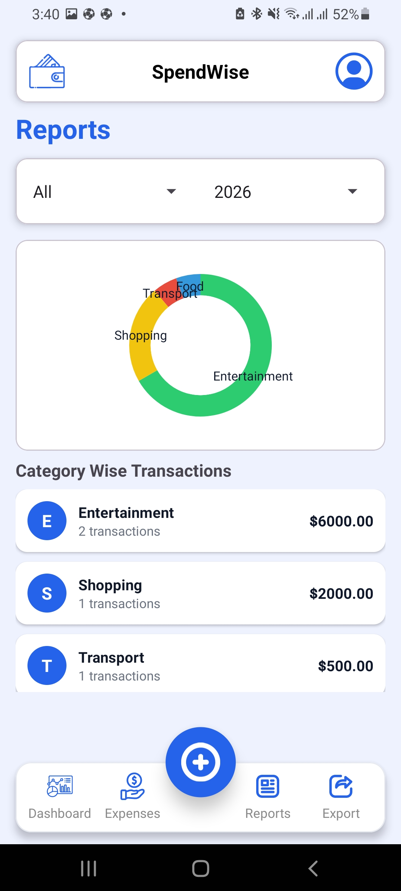<br/>
      <b>Reports</b><br/>
      <sub>Summary of exportable data</sub>
    </td>
    <td align="center" width="450">
      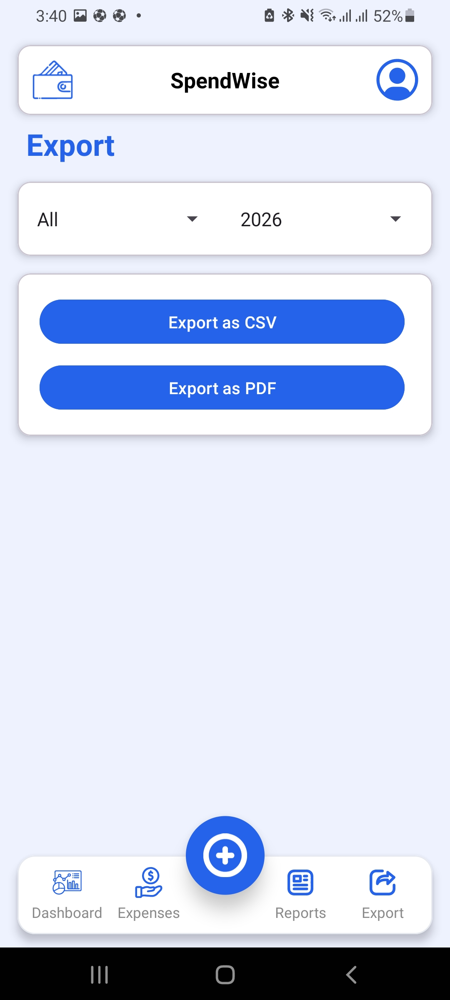<br/>
      <b>CSV/PNG Export</b><br/>
      <sub>Download raw expense data</sub>
    </td>
  </tr>
</table>

### Intuitive App Screens — Profile Management

<table>
  <tr>
    <td align="center" width="300">
      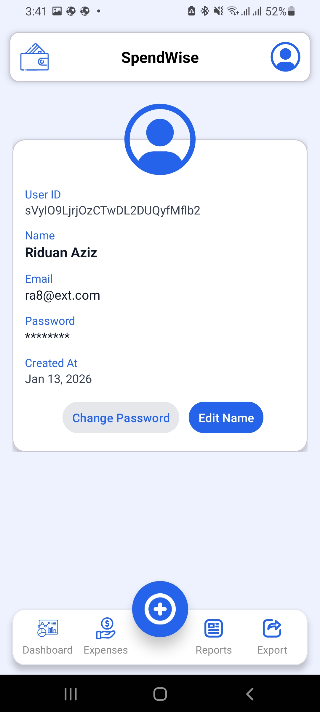<br/>
      <b>Profile Overview</b><br/>
      <sub>User account information</sub>
    </td>
    <td align="center" width="300">
      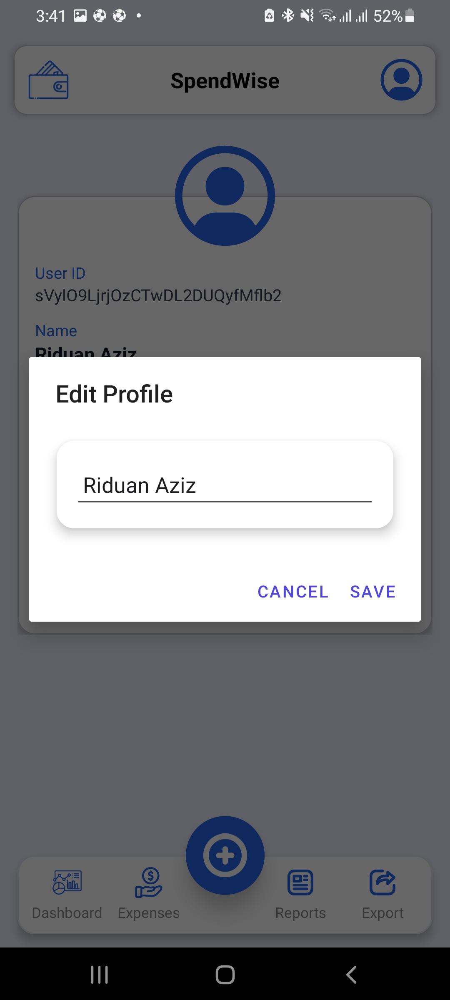<br/>
      <b>Edit Profile</b><br/>
      <sub>Update name and preferences</sub>
    </td>
    <td align="center" width="300">
      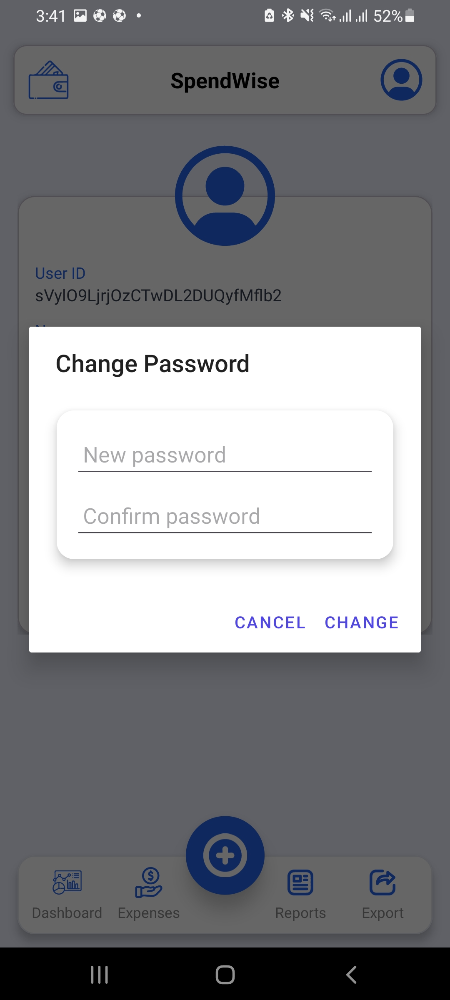<br/>
      <b>Password Management</b><br/>
      <sub>Secure password update</sub>
    </td>
  </tr>
</table>

---

## 🔐 Firebase Database Structure

```bash
  Root
  │
  ├── users
  │   ├── {authUid_1}
  │   │   ├── profile
  │   │   ├── expenses
  │   │   ├── categories
  │   │   └── summaries
  │   ├── {authUid_2}
  │   │   ├── profile
  │   │   ├── expenses
  │   │   ├── categories
  │   │   └── summaries
  │   └── ...
  │
  ├── appSettings
  │   ├── categories
  │   ├── currency
  │   └── defaultView
  │
  └── meta
      ├── lastUpdated
      └── version
```

---

## 🗄️Database Schema (Firebase Realtime Database)

```json
{
  "users": {
    "<authUid_1>": {
      "profile": {
        "authUid": " ",
        "uid": " ",
        "email": " ",
        "name": " ",
        "createdAt": 
      },
      "expenses": {
        " ": {
          "id": " ",
          "amount":  ,
          "category": " ",
          "note": " ",
          "date": " ",
          "timestamp":  
        },
      "summaries": {
        "global": {
          "total":  ,
          "byCategory": {
            "Food":  ,
            "Transport":  ,
            "Utilities":  ,
            "Other":  
          },
          "byMonth": {
            "2026-01": {
              "total":  ,
              "Food":  ,
              "Other":  
            },
            "2025-12": {
              "total":  ,
              "Transport":  ,
              "Utilities":  ,
              "Other":  
            }
          }
        }
      }
    },
  },
  "appSettings": {
    "categories": {
      "Food": true,
      "Transport": true,
      "Utilities": true,
      "Entertainment": true,
      "Other": true
    },
    "currency": "USD",
    "defaultView": "dashboard"
  },
  "meta": {
    "lastUpdated":  ,
    "version": "1.0.0"
  }
}
```

---

## 🔒 Firebase Security Rules

```json
{
  "rules": {
    "users": {
      "$uid": {
        ".read": "auth != null && auth.uid === $uid",
        ".write": "auth != null && auth.uid === $uid",

        "profile": {
          ".validate": "newData.hasChildren(['authUid','email','name','createdAt'])"
        },

        "expenses": {
          "$expenseId": {
            ".validate": "newData.hasChildren(['amount','category','date','timestamp'])"
          }
        },

        "summaries": {
          ".read": "auth != null && auth.uid === $uid",
          ".write": "auth != null && auth.uid === $uid"
        }
      }
    },

    "appSettings": {
      ".read": true,
      ".write": false
    }
  }
}
```

---

## ⚙️ Setup Instructions

### Clone Repository
```bash
git clone https://github.com/RiduanAziz/SpendWise-Smart-Expense-Tracker.git
cd SpendWise-Smart-Expense-Tracker
```

### Add Firebase Config
```bash
app/google-services.json
```

### Build Project
```bash
./gradlew build
```

### Run App
```bash
./gradlew installDebug
```

---

## 🧪 Testing Summary
### Test Case	Description	Result
| Test | Description    | Status |
| ---- | -------------- | ------ |
| TC01 | Login          | ✅ Pass |
| TC02 | Add Expense    | ✅ Pass |
| TC03 | Edit Expense   | ✅ Pass |
| TC04 | Export CSV/PDF | ✅ Pass |
| TC05 | Invalid Login  | ✅ Pass |

---

## 🚀 Deployment Checklist
### 🔹 Android App

 - App builds without errors
 - Minimum SDK set to API 26+
 - App icon & name finalized
 - Proguard rules configured
 - Debug logs removed

### 🔹 Firebase

 - Firebase Authentication enabled
 - Realtime Database rules applied
 - Test unauthorized access (should fail)
 - Database indexes added if needed
 - Backup database before release
   
### 🔹 Security
  - No API keys hardcoded
  - Firebase rules tested
  - User data isolation verified

### 🔹 Performance
 - Dashboard loads < 1 second
 - RecyclerView pagination tested
 - Offline sync verified

### 🔹 Documentation
- README updated
- Screenshots added
- Project report finalized

---

## 🔮 Future Enhancements
- Budget alerts
- Yearly analytics
- Multi-currency support
- Cloud Functions
- Backup & restore

---

## 👨‍💻 Authors

Riduan Aziz

---

## 📄 License

This project is developed for academic purposes under
CSE-3111 Software Development Project.
All rights reserved.

---
